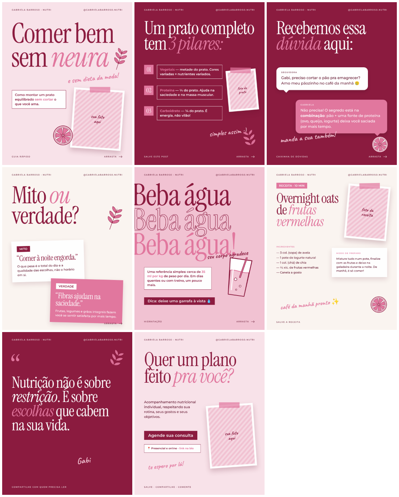

# Padrão de publicação — @gabrielabarroso.nutri

Identidade visual para o Instagram da nutricionista Gabriela Barroso.
Clima: **feminino, editorial e acolhedor**. Títulos grandes em serifa condensada, cores vinho e rosa, detalhes "feitos à mão" (manuscrito, fita adesiva, fotos recortadas) e textos de apoio curtos.



---

## 1. Paleta

| Cor | HEX | Uso |
|---|---|---|
| **Vinho** | `#8C1C40` | Cor principal: fundos fortes, títulos em fundo claro |
| **Vinho escuro** | `#5E0F29` | Texto corrido em fundo claro, contornos |
| **Rosa** | `#E2789F` | Palavra-destaque do título, tags, numeração |
| **Rosa claro** | `#F2C3D3` | Fundo suave, marca-texto |
| **Blush** | `#F9E3EA` | Fundo claro principal (capas, CTA) |
| **Creme** | `#FBF5F1` | Fundo neutro (receitas, mito x verdade) |
| **Branco** | `#FFFFFF` | Cards, balões, moldura das fotos |

**Regra de alternância no feed:** intercale fundo claro (blush/creme/rosa claro) com fundo vinho, para o perfil formar um "xadrez" como na grade acima.

## 2. Tipografia

| Função | Fonte | Detalhes |
|---|---|---|
| Títulos | **Instrument Serif** | 110–230 px, entrelinha 0,86, espaçamento −2,5%. Destaque em *itálico rosa* |
| Texto de apoio | **Montserrat** | 500/600, 24–31 px. Negrito em rosa para destacar |
| Manuscrito | **Caveat** 700 | 54–70 px, inclinado −6°, rosa. Um por post, no máximo |
| Etiquetas | Montserrat 600 | 16–17 px, caixa alta, espaçamento 0,16em |

As fontes estão em `assets/fonts/` (funcionam offline). Para usar no Canva: todas são Google Fonts gratuitas.

## 3. Elementos visuais

- **Título misto**: 1 ou 2 palavras-chave em *itálico rosa*; o resto em vinho (fundo claro) ou branco (fundo vinho).
- **Cabeçalho fixo**: "GABRIELA BARROSO · NUTRI" à esquerda e "@GABRIELABARROSO.NUTRI" à direita.
- **Rodapé**: chamada curta ("Salve este post") + "ARRASTA ⟶" nos slides do meio do carrossel.
- **Caixa com contorno**: texto curto dentro de uma borda fina (como uma etiqueta).
- **Tag rosa ou vinho**: faixa sólida para chamadas ("Agende sua consulta", "RECEITA · 10 MIN").
- **Numeração**: quadradinho rosa com 01, 02, 03 em serifa.
- **Balões de conversa**: branco para a pergunta, rosa para a resposta da nutri.
- **Foto recortada**: moldura branca, levemente girada (±4°), com fita adesiva rosa.
- **Título repetido**: mesma frase 3x (cheio / contorno / rosa) para temas-chave.
- **Ilustrações**: folha, rodela de limão/laranja, copo d'água, maçã (`assets/ilustracoes/`). Use 1 ou 2 por post.
- **Textura**: pontilhado sutil de papel em todos os fundos.

## 4. Tipos de post (templates)

| Arquivo | Tipo | Fundo |
|---|---|---|
| `01-capa.html` | Capa de carrossel | Blush |
| `02-topicos.html` | Lista numerada (passo a passo) | Vinho |
| `03-duvida.html` | Dúvida de seguidor (balões) | Vinho |
| `04-mito-verdade.html` | Mito ou verdade | Creme |
| `05-repeticao.html` | Título repetido + dica | Rosa claro |
| `06-receita.html` | Receita | Creme |
| `07-frase.html` | Frase de destaque | Vinho |
| `08-cta.html` | Chamada final / agendamento | Blush |
| `09-story.html` | Story (1080×1920) caixinha de perguntas | Vinho |

**Carrossel sugerido:** capa → 3 a 6 slides de conteúdo → CTA.

## 5. Como usar

1. Copie um template de `templates/` e edite os textos no HTML.
2. Para colocar sua foto, salve-a em `assets/fotos/` e troque o `<div class="img">…</div>` por
   `<div class="img" style="background-image:url(../assets/fotos/minha-foto.jpg)"></div>`.
3. Exporte em PNG (1080×1350, formato retrato do feed):
   ```bash
   node scripts/exportar.js           # todos
   node scripts/exportar.js 01-capa   # só um
   ```
   Os arquivos saem em `exports/`, junto com a grade `00-grade-preview.png`.

> Requer Node.js e Playwright (`npm i playwright && npx playwright install chromium`).

## 6. Regras rápidas

- No máximo **12 palavras** no título e **30 palavras** no texto de apoio por slide.
- Margem lateral de **80 px**, sem texto encostando na borda.
- Uma ideia por slide.
- Rosa só para destaque, nunca em blocos grandes de texto.
- Sempre fechar o carrossel com uma chamada (salvar, compartilhar, agendar).
